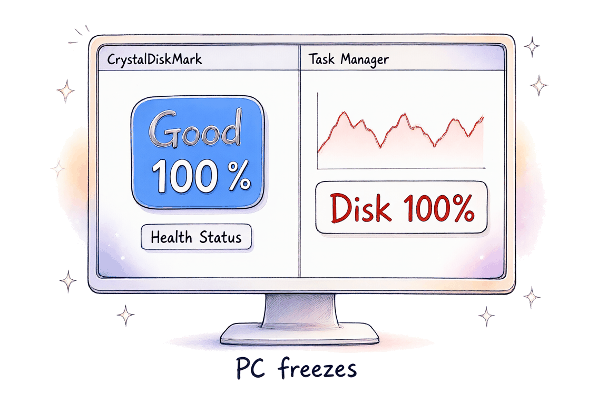
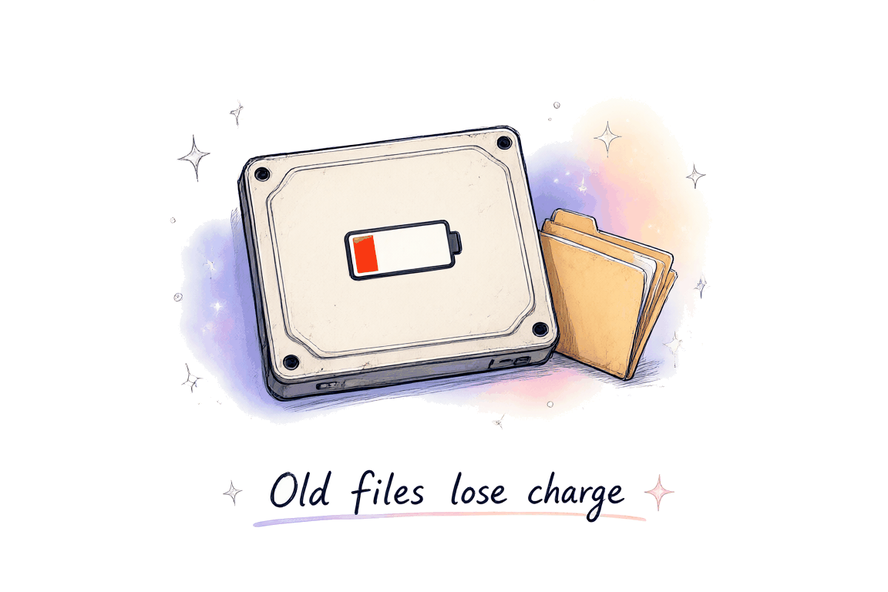
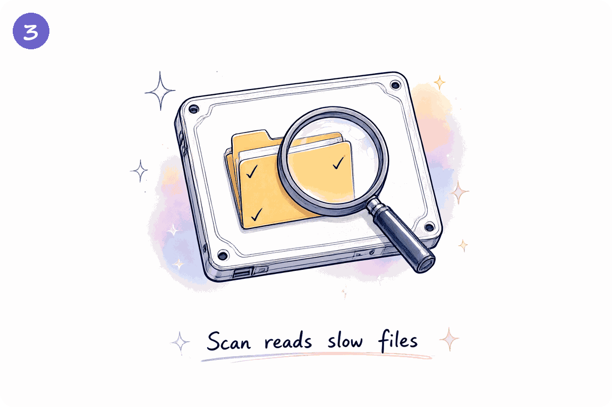
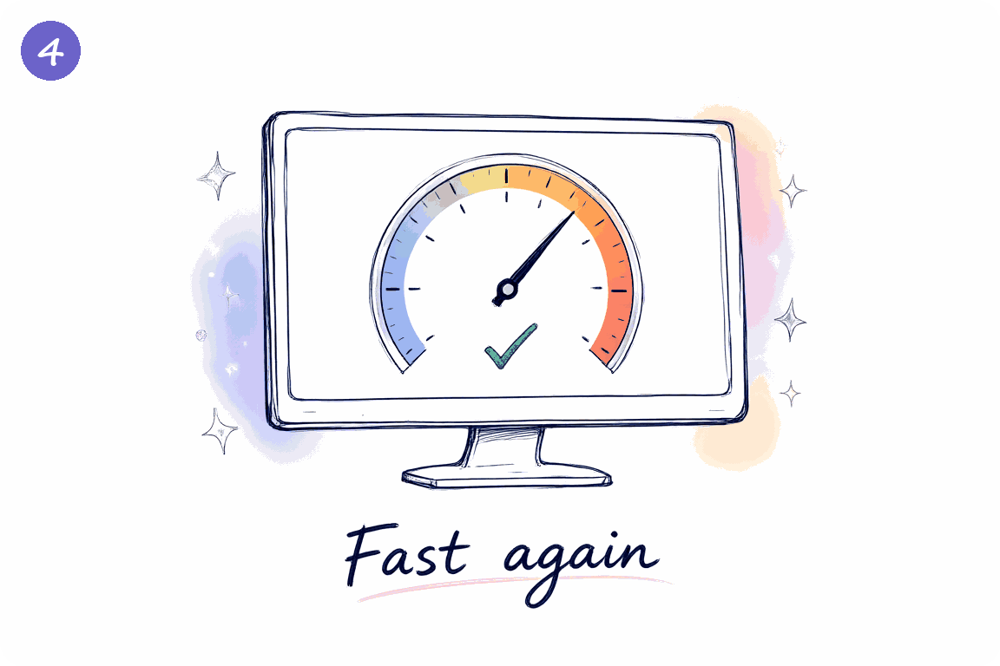
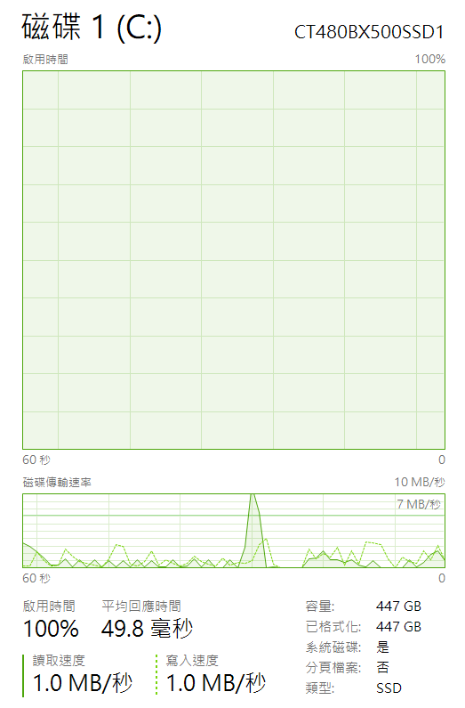

<div align="center">

<h1>ssd-refresh（繁體中文說明）</h1>

[](https://github.com/zenshay/ssd-refresh/releases)
[](#授權)
[](#建置)
[](#支援的平台與架構)
[-blue)](#支援的平台與架構)
[](#安全測試windows)

<p align="center">
  
</p>

[English](README.md)

</div>

**舊檔案讀取變慢？先做唯讀掃描。**

<p align="center">
  
  
  
  
</p>

效果取決於磁碟。圖中文字為英文。

## 電腦常常卡住嗎？

Windows 可能顯示**磁碟使用率 100%**，讀取卻只有 **1 MB/s**。
SSD 內儲存的電荷會慢慢流失。舊檔案可能因此變慢。
ssd-refresh 找出慢檔案，並讀取檔案。
讀取可能觸發 SSD 內部處理。請量測自己的磁碟，效果沒有保證。
效果取決於磁碟。流程圖呈現的是一種可能結果。

## 下載與開始

從 [GitHub Releases](https://github.com/zenshay/ssd-refresh/releases) 下載 Windows 桌面版。
Windows 10/11 選 `ssd-refresh-gui-v1.0.2-windows-x64.zip`。
Windows on ARM 的檔案是 `ssd-refresh-gui-v1.0.2-windows-arm64.zip`。
解壓縮 ZIP 檔案，再執行程式。程式介面使用英文。
桌面版需要 Microsoft Edge WebView2 Runtime。
Windows 程式尚未簽署，Windows 或安全軟體可能顯示警告。
執行前請確認發行來源。不要停用安全防護來消除警告。
Windows ARM64 套件採交叉編譯。建置成功不代表已通過 ARM 實機測試。
其他系統與命令列工具，請看[完整下載清單](#下載)。

1. 先備份重要檔案。
2. 先執行 `scan`。掃描會讀取檔案並測量速度。
3. 隔 1 天再掃描。若檔案讀取已恢復，就到這裡停止。
4. 若檔案仍然慢，先讀[刷新說明](#刷新)與[風險](#風險)，再使用 `refresh`。

**scan 會重寫檔案嗎？NO。** 工具只讀取檔案，並儲存報告。
SSD 可能在讀取後自行重寫內部資料。
**refresh 會寫入資料嗎？YES。** 它會搬移慢檔案，並跳過空白空間。
這個工具不能修好故障的磁碟。

---

## 給開發者

### 症狀與掃描細節



#### 碰到的問題
SSD 的 SMART 健康度顯示 100% 良好。但是開程式或開遊戲時，電腦會突然凍結卡住。打開 Windows 工作管理員，看到**磁碟使用率（啟用時間）100%**，但讀取速度卻只有 **1 MB/s**。

#### 為什麼會這樣
快閃記憶體單元的電荷會隨著時間自然流失。
當檔案存了幾個月或幾年沒有更動（例如 Windows 系統檔案或安裝好的遊戲），SSD 控制器很難讀出資料。
控制器必須反覆嘗試並啟動重度錯誤校正（ECC）。
讀取速度就會從原本的 500 MB/s 暴跌到 5–30 MB/s。

#### 為什麼 Windows 內建的「重組並最佳化磁碟」沒用
Windows 內建的 SSD 最佳化只會送出 TRIM 指令來標記已刪除的空白空間。
它完全不會讀取或刷新已經寫入的舊檔案。

#### 解決方案：ssd-refresh
ssd-refresh 找出真正變慢的檔案，請作業系統將它們搬移重寫到新的健康區塊。
1. **唯讀掃描**：部分 SSD 可能在讀取後恢復速度。工具不寫入檔案資料，但 SSD 可能自行寫入內部資料。
2. **精準重寫**：如果讀完依然慢，只重寫真正變慢的檔案。跳過健康的檔案與空白磁區。
3. **檔案系統搬移**：Windows 使用 `FSCTL_MOVE_FILE` 等系統 API 協調檔案存取。這些介面不能排除所有故障。

---

### 工具比一比：ssd-refresh vs DiskFresh vs Windows 磁碟最佳化

| 功能特色 | ssd-refresh | DiskFresh 等全碟磁區工具 | Windows 最佳化 (TRIM) |
|---|---|---|---|
| **處理層級** | 檔案層級（只針對變慢的檔案） | 實體磁區（整顆磁碟所有磁區） | 僅標記空白空間 (TRIM) |
| **會重寫空白區嗎？** | **不會**（省下 SSD 壽命與 TBW） | 會（浪費 SSD 壽命） | 不會 |
| **並行存取** | 系統協調搬移；仍可能失敗 | 取決於工具與模式 | Windows 管理 |
| **執行耗時** | **快速**（幾分鐘，只處理慢檔） | 緩慢（數小時，掃瞄整顆硬碟） | 幾秒鐘 |
| **唯讀喚醒自癒模式？** | **有**（只讀掃描，0 寫入） | 需手動切換唯讀模式 | 無 |
| **能看出哪些檔案慢嗎？**| 能列出每一個慢速檔案路徑 | 無（只能看到磁區號碼） | 無 |
| **現代與開源** | **是**（純 Rust 開發，單檔 600 KB） | 否（多年未維護的舊閉源軟體） | 系統內建 |

---

### 一般使用者操作步驟

**請先從 `scan` 開始，不要直接 `refresh`。**

1. **第一步：唯讀掃描（Scan）**。對磁碟執行 `scan`，量測檔案讀取。部分磁碟可能在讀取後恢復速度，請量測自己的磁碟。
2. **第二步：隔天檢查**。隔天再跑一次 `scan`（或 `verify --from`）。如果慢檔已經恢復高速，就已經完成修復！工具沒有重寫檔案資料，但 SSD 可能自行寫入內部資料。
3. **第三步：刷新（Refresh，僅在仍變慢時執行）**。先閱讀風險，再用 `refresh` 請檔案系統搬移慢檔。

---

### 運作原理

快閃記憶體的電荷會慢慢流失。很久以前寫入、之後一直沒改過的資料，SSD 要反覆重試、加強錯誤校正才讀得出來，速度就掉下來。

實例：一顆用了 5.4 年的 Crucial BX500 480 GB，讀多年前寫入的檔案只有 5–35 MB/s。同一批檔案複製一份後，新的複本約 500 MB/s。

DiskFresh 這類整顆磁碟的刷新工具，做法是把每個磁區讀出來再寫回去，有兩個問題：

1. 使用中的磁碟上，程式可能在工具讀出之後、寫回之前改了那個磁區。工具寫回時就把新資料蓋成舊內容。
2. 空白區域也會被重寫，浪費 SSD 的寫入壽命，事後還要再做一次 TRIM。

ssd-refresh 以檔案為單位，預設只搬移仍然慢的檔案。
工具使用檔案系統的搬移 API 協調並行存取。
工具比較搬移前後的雜湊與中繼資料。
這些檢查用於降低風險，不代表可以排除所有故障。

和其他工具的差別：

- DiskFresh、SpinRite、Hard Disk Sentinel 和 `chkdsk /r` 都以磁區為單位。它們都不會列出哪些檔案慢，而且在使用中的磁碟上寫回磁區並不安全。
- Sysinternals Contig 用的是同一個搬移 API，但它會跳過沒有碎片的檔案，所以不能用來刷新。
- 依修改日期挑檔案的工具看不出哪些檔案真的慢。舊檔不一定慢，慢檔也不一定舊。

### 什麼時候用

適合：

- 檔案多年沒有改動的系統碟。
- 遊戲庫與封存資料：寫入一次、很少讀取。
- 長期沒有通電存放的磁碟。

不適合：

- SMART 的重新配置磁區數持續增加。請先備份並換碟，不要再增加寫入。
- 傳統硬碟（HDD）。它們不會因為這個原因變慢。
- 最近才寫入的資料。它變慢不是因為放太久。

#### 哪些磁碟

下表的風險是**根據公開資訊推測，不是本專案實測**。請用 `scan` 和 `verify` 量自己的磁碟，實測結果見[實測過的磁碟](#實測過的磁碟)。

| 磁碟類型 | 推測的舊資料變慢風險 |
|---|---|
| QLC（每個單元 4 位元） | 高 |
| 早期平面 TLC，例如 Samsung 840 EVO | 高 |
| 沒有 DRAM 的 SATA | 中到高 |
| 沒有 DRAM 的 NVMe | 未知，尚待實測 |
| 有 DRAM 的主流 TLC | 低 |
| microSD 卡、隨身碟 | 很高（而且通常是 exFAT/FAT32，只能掃描） |

### 實測過的磁碟

下列結果來自 DiskFresh 唯讀模式的觀察。
這不是 ssd-refresh 的效益實測，也不能推廣到其他磁碟。

| 磁碟 | 介面 | NAND／DRAM | 結果 | 日期 |
|---|---|---|---|---|
| Crucial BX500 480 GB | SATA | 沒有 DRAM | 讀一遍就恢復：做一次唯讀掃描（DiskFresh 唯讀模式）後，舊檔讀取 250–470 MB/s，卡頓從每天 129 次降到 5 次 | 2026-10-15 |

結果分三種：*讀一遍就恢復*（read-only pass enough）、*需要重寫*（rewrite needed，只有重寫過的檔案恢復）、*沒有變慢*（no slowdown，舊檔本來就不慢）。

請用 [drive report](https://github.com/zenshay/ssd-refresh/issues/new?template=drive-report.yml) 範本回報不含敏感資訊的結果。
摘要中的檔名、使用者名稱與路徑須先遮蔽。不要附上完整 log 或 CSV。

### 下載

至 [GitHub Releases](https://github.com/zenshay/ssd-refresh/releases) 下載預先編譯好的安裝包：

| 套件檔名 | 適用平台與架構 | 說明 |
|---|---|---|
| **`ssd-refresh-gui-v1.0.2-windows-x64.zip`** | Windows 10/11 (`x86_64`) | 桌面 GUI；需要 WebView2。 |
| **`ssd-refresh-gui-v1.0.2-windows-arm64.zip`** | Windows on ARM (`aarch64`) | 交叉編譯 GUI；此處沒有 ARM 實機執行證據。 |
| **`ssd-refresh-cli-v1.0.2-windows-x64.zip`** | Windows 10/11 (`x86_64`) | 命令列工具。 |
| **`ssd-refresh-cli-v1.0.2-windows-arm64.zip`** | Windows on ARM (`aarch64`) | 交叉編譯 CLI；此處沒有 ARM 實機執行證據。 |
| **`ssd-refresh-cli-v1.0.2-linux-x64.tar.gz`** | Linux (`x86_64`) | 命令列工具。 |
| **`ssd-refresh-cli-v1.0.2-macos-universal.tar.gz`** | macOS (`Apple Silicon & Intel`) | 通用版 CLI；支援掃描與驗證。 |

這些檔名適用於 v1.0.2。其他版本請核對發行頁的檔案清單。

### 支援的平台與架構

CLI 的目標平台是 Windows、Linux 與 macOS。桌面 GUI 目前只發行 Windows 版本。
下表描述程式已實作的功能，不等於硬體測試涵蓋範圍。
Linux ARM64 可以從原始碼建置；上述 Linux 發行檔只有 x64。
交叉編譯成功不代表已在實體裝置執行。

| 平台 | 硬體架構 | 檔案系統 | 掃描 | 刷新 |
|---|---|---|---|---|
| Windows 10/11 | `x86_64`, `aarch64` (ARM64) | NTFS | 支援 | 已實作（`FSCTL_MOVE_FILE`）；測試範圍見下文 |
| Linux | `x86_64`, `aarch64` (ARM64) | ext4 | 支援 | 支援（`EXT4_IOC_MOVE_EXT`） |
| Linux | `x86_64`, `aarch64` (ARM64) | btrfs、XFS | 支援 | 不支援 |
| macOS | `Apple Silicon`, `Intel` | APFS | 支援（整檔測速） | 不支援：APFS 沒有能安全搬移使用中檔案的 API |

### 建置

CLI 原始碼需要 Rust 1.83 以上。
GUI 目前的相依套件需要 Rust 1.90 以上。
GUI 建置還需要 Node.js 24 與 pnpm 12.14.0。
Windows 需要 MSVC C++ Build Tools、Windows SDK 與 WebView2 Runtime。
其他平台建置工具見 [Tauri 前置需求](https://v2.tauri.app/start/prerequisites/)。

以下以 Windows 專案路徑 `C:\src\ssd-refresh` 為例。
請改成自己的專案絕對路徑。這些指令不會執行掃描或刷新。

1. 使用既有 lockfile 建置 CLI：

   ```powershell
   cargo build --manifest-path C:\src\ssd-refresh\Cargo.toml --locked --release --bin ssd-refresh
   ```

2. 安裝 Node.js 24 後，安裝 pnpm 12.14.0：

   ```powershell
   npm install --global pnpm@12.14.0
   ```

3. 安裝前端相依套件：

   ```powershell
   pnpm --dir C:\src\ssd-refresh\gui install --frozen-lockfile
   ```

4. 先建置前端資產：

   ```powershell
   pnpm --dir C:\src\ssd-refresh\gui run build
   ```

5. 使用 Rust 1.90 以上建置桌面程式：

   ```powershell
   cargo build --manifest-path C:\src\ssd-refresh\Cargo.toml --locked --release -p ssd-refresh-gui
   ```

執行檔位於專案的 `target\release`。
Linux 與 macOS 可在專案根目錄用 `cargo build --locked --release --bin ssd-refresh` 建置 CLI。

程式的畫面與說明都是英文。`ssd-refresh help scan`、`ssd-refresh help refresh` 有每個選項、進度欄位與狀態的完整說明。

### 快速開始（Windows）

用「以系統管理員身分執行」開 PowerShell：

```powershell
ssd-refresh scan C:\ --out C-scan.csv
ssd-refresh refresh --from C-scan.csv --dry-run
ssd-refresh refresh --from C-scan.csv --allow-system-volume
Optimize-Volume -DriveLetter C -ReTrim
```

1. 掃描磁碟，產生報告。
2. 試跑：重新測量慢的檔案，不搬移任何東西。
3. 刷新。開始前要輸入磁碟代號確認。
4. 告訴 SSD 舊的位置已經空出來。

Linux 用 `sudo` 執行，第 4 步改成 `sudo fstrim -v /`。

**選用，隔一天以上再做：** 確認資料安全，而且檔案仍然夠快。見[驗證](#驗證刷新的效果能不能維持)。

```powershell
ssd-refresh verify --from C-scan-refresh.csv
```

### 掃描

```
ssd-refresh scan <資料夾或檔案> [--out 報告.csv] [--resume] [--hash] [--parallel 8]
```

掃描分三步。每一步開始前，程式會先印出這一步要做什麼。

1. **Find the files（列出檔案）**：掃描會走訪所有資料夾。它不進入符號連結、junction 和掛載點，也不跨到別的磁碟區。
2. **Read each file one time（每個檔案讀一次）**：掃描不經系統快取，直接從磁碟讀每個檔案。它量每個 extent 的時間。extent 是檔案在磁碟上的一段連續資料。只要有一個 extent 低於 `--threshold`（100 MB/s），這個檔案就列入**待確認清單（check list）**。
3. **Check the files on the check list again（再確認一次）**：掃描用一般 I/O 優先權，一次只讀一個檔案。它讀兩輪，第二輪在第一輪開始 30 秒以上之後才開始。每個 extent 取三次讀取中最快的一次。這樣還是慢，檔案才算**慢（slow）**。

#### 待確認清單不是結果

第 2 步追求速度，它的測速單獨看並不可靠：

- **同時讀多個檔案。** 小檔一次只需要一個讀取請求，一個一個讀的話，SSD 的指令佇列幾乎是空的。所以第 2 步同時讀 8 個檔案：4 MiB 以上的大檔一次一個（每個同時排 4 個請求），小檔一次 7 個。共用磁碟的讀取會互相等待，所以第 2 步每個 extent 容許的額外延遲是 8 × 2 ms，第 3 步則是正常的 2 ms。
- **第 2 步用最低的 I/O 優先權**，讓其他程式先用磁碟。只要有其他程式在用磁碟，Windows 就會壓低最低優先權 I/O 的速度，健康的檔案也可能看起來很慢。
- **SSD 本身會暫時變慢。** 沒有 DRAM 的 SSD 閒置一段時間後會做內部整理，接下來 10–20 秒的讀取全部變慢。

所以第 2 步只產生待確認清單。它的進度列計算的是清單上的檔案數，不是慢檔數。第 3 步在沒有這些干擾的情況下，於兩個不同時間點重新測量。做完第 3 步，才知道慢檔有幾個。

#### 進度列

進度列原地更新，寬度配合視窗。寬的視窗顯示完整欄位名稱，窄的視窗顯示簡寫。

第 2 步：

```
12.3%  35.2G of 290G  245 MB/s  check 17  errors 0  left 17m20s (done ~11:05)
12.3% 35.2G/290G 245MB/s chk 17 17m20s
```

| 欄位 | 意思 |
|---|---|
| `12.3%` | 已讀的位元組占要讀總量的比例 |
| `35.2G of 290G` | 已讀／要讀的位元組（1G = 10^9 位元組） |
| `245 MB/s` | 第 2 步開始以來的平均速度 |
| `check 17` | 待確認清單上的檔案數。這不是結果 |
| `errors 0` | 開不了或讀不了的檔案數 |
| `left` | 照目前平均速度估計的剩餘時間，以及預計完成時刻 |

小檔很多的資料夾，百分比會前進得很慢。這些檔案位元組少，但每個都要開一次。

第 3 步：

```
Check again 1/2  120 of 3,020 files  1.2G of 3.4G  slow 15  left 2m10s
```

`slow` 是這一輪目前仍然慢的檔案數。

#### 報告欄位

| 欄位 | 意思 |
|---|---|
| `path`、`size` | 檔案路徑與大小 |
| `kind` | `normal`、`sparse`、`encrypted`：有測速、可刷新。`unknown`：有測速、不可刷新（macOS）。`resident`（資料在 MFT 或 inode 裡）、`empty`、`compressed`、`wof`（Windows 壓縮的系統檔）、`shared`（reflink）、`reparse`：不測速 |
| `extents` | 有實體位置的資料段數 |
| `disk_bytes`、`read_ms`、`mbps` | 從磁碟讀的位元組、時間、平均速度 |
| `min_extent_mbps` | 最慢那段的速度 |
| `slow`、`slow_bytes` | 1 = 第 3 步後判定為慢；慢的那幾段共幾位元組 |
| `confirmed` | 1 = 第 3 步重新確認過 |
| `sha256` | 加 `--hash` 時才有 |
| `status` | `OK`（有測速）、`SKIP`（不測速，見 `kind`）、`DUP_LINK`（硬連結，同一個檔案已測過）、`ERROR`（見 `error`） |

### 刷新

```
ssd-refresh refresh --from 報告.csv [--dry-run] [--allow-system-volume] [--resume]
```

需要系統管理員（Windows）或 root（Linux）。

1. **Choose files and check the volume（選檔並檢查磁碟區）**：預設只取確認為慢的檔案（`--select all` 取所有有測速的檔案），並檢查檔案系統與權限。系統磁碟要加 `--allow-system-volume`。
2. **What will happen（說明並確認）**：列出會發生什麼事、會寫入多少資料，以及警告（例如 Windows 還原點）。輸入磁碟代號才會開始，其他輸入都會取消。腳本可用 `--confirm X:` 略過這一步。
3. **Refresh（刷新）**，一次一個檔案：
   1. 不經快取、用一般優先權讀檔，記錄 SHA-256 與速度。
   2. 已經不慢就跳過（`SKIP_FAST`），除非加 `--force`。
   3. 請檔案系統把資料搬到空的叢集，每次最多 16 MiB。每次搬移都是原子操作：要嘛整段搬好，要嘛完全沒動。
   4. 再讀一次，比對 SHA-256，記錄新的速度。

進度列：

```
Refresh 12 of 340 files  1.2G of 4.5G  30 MB/s  moved 10  changed 1  skipped 1  failed 0  left 3m20s
```

`moved` 包含 `changed`。`skipped` 是已經不慢、不能搬、已不存在或試跑的檔案。
`failed` 是沒能搬移或讀取的檔案。再次操作前，請檢查 `detail` 與備份。

#### 記錄檔的狀態

| 狀態 | 意思 |
|---|---|
| `OK` | 已搬移，前後雜湊一致 |
| `CHANGED` | 已搬移，但搬移期間有其他程式寫入這個檔案，所以雜湊不同。使用中的檔案屬正常 |
| `SKIP_FAST` | 重新測量後已經不慢，沒有搬 |
| `SKIP_KIND` | 不能搬的種類（見 `detail`） |
| `SKIP_MISSING` | 檔案已經不存在 |
| `DRYRUN` | `--dry-run`：只測量 |
| `MOVE_FAILED` | 檔案系統搬移失敗。請看 `detail`；這個狀態本身不能證明資料完整 |
| `PARTIAL` | 中途停止；`--resume` 會重搬 |
| `MISMATCH` | 雜湊變了，而且沒有偵測到其他寫入者。程式立刻停止。這不應該發生，請回報 |
| `CONTROL` | 對照組（`--control-fraction`）：仍然慢，只讀取，刻意不搬 |
| `ERROR` | 開不了或讀不了（見 `detail`） |

#### 雜湊不同時怎麼判斷

雜湊不同時，程式檢查兩件事：

- 檔案的大小、修改時間、變更時間、USN（NTFS）有沒有變。
- 有沒有其他程式開著寫入。Windows 會用「不允許別人寫入」的共用模式開檔一瞬間測試；Linux 用讀取租約（`F_SETLEASE`）測試。
任一項成立就記成 `CHANGED`，否則記成 `MISMATCH`。

搬移前讀取之前，工具會先把這個檔案在快取裡的資料寫進磁碟（flush）。原因是程式可能透過快取寫入後就關檔，新資料會在快取裡留幾秒。本工具的讀取不經快取，不先 flush 的話，可能讀到磁碟上的舊資料。Windows 上，工具用允許所有共用的寫入權限開檔（不會擋住其他程式），呼叫 `FlushFileBuffers`。它不寫入任何資料，檔案時間也不會變。Linux 上呼叫 `fsync`。flush 失敗時（例如沒有寫入權限），工具會記在 `detail` 欄。這時 SHA-256 不同，照樣判成 `MISMATCH`。

### 驗證：刷新的效果能不能維持

`verify` 是給刷新過的人用的。刷新後隔一段時間（至少隔天，之後可以每月一次），它會重讀刷新記錄裡的檔案，回答三個問題：刷新有沒有效、效果維持多久、什麼時候該再掃描。

一定要隔一段時間。刷新記錄的 `after_mbps` 是搬移後立刻量的，不準：剛寫入的資料一定快，可能還在 SSD 的 SLC 快取裡。`verify` 的價值就在「隔一段時間再量」。

1. 刷新後等一天以上。距離刷新不到 12 小時，速度的判斷會顯示 `NOT DECIDED`（不下結論）。
2. 重讀檔案：

   ```powershell
   ssd-refresh verify --from C-scan-refresh.csv
   ```

3. 之後再定期執行同一個指令，例如每月一次。刷新過的檔案又變慢時，就該重新掃描了。

另外有兩個現象會混淆結果：

- 只讀一遍也可能讓速度恢復。SSD 讀取時如果需要大量錯誤校正，可能會自己把資料重寫一次（常稱為 read reclaim）。曾觀察到 Crucial BX500 只做一次唯讀掃描（例如 DiskFresh 唯讀模式），舊檔就恢復到 250–470 MB/s。
- 單次讀得慢可能只是停頓（沒有 DRAM 的 SSD 閒置後 10–20 秒會變慢），不代表檔案慢。

想知道你的 SSD 屬於哪一種，見[幫忙測試你的 SSD](#幫忙測試你的-ssd)。

`verify` 一次只讀一個檔案，用一般優先權，不經作業系統快取；讀得慢的檔案會再讀一次，每個 extent 取較快的時間。`--out` 的 CSV 另外保留第一次讀取的結果（`first_*` 欄位）。它會分別列出 `rewritten` 組（`OK`、`CHANGED`）和 `read_only` 組（`CONTROL`、`DRYRUN`，有的話），格式如下（數字只是示意）：

```
Summary
                           Rewritten  Read only
  Files read                      60         60
  Files measured                  58         60
  Slow before->now             58->1     60->41
  Median MB/s before->now     38->455    35->120
  Changed by a program             2          0
```

- 「before」是搬移前那次讀取（掃描報告則是掃描結果）。「now」是這次重讀。
- 被程式改過的檔案存的是新資料。`verify` 不把它列入比較（`MODIFIED`）。
- `--sample N`：每組最多讀 N 個檔案。抽樣由路徑決定，之後重跑會讀同一批。
- `verify --from C-scan.csv`：檢查掃描報告裡的慢檔，看只讀一遍是否已經讓它們恢復。

#### 結論：資料安不安全、快了幾倍

表格之後，`verify` 直接回答三個問題（數字只是示意）：

```
Result
  Data safe:          YES  597 of 597 files that no program changed have the same SHA-256 as at
                           refresh. 3 files were changed by other programs after the refresh.
                           This is normal.
  Faster (rewritten): YES  340 files were slow before. 3 files are slow now. Read speed: 25 MB/s
                           before, 414 MB/s now (16.5 times faster).
  Faster (read only): NOT DECIDED  Only 4 slow files. Need 10 or more. 4 files were slow before.
                                   3 files are slow now. Read speed: 30 MB/s before, 45 MB/s now
                                   (1.5 times faster).
  Conclusion:         NOT DECIDED  Only 4 slow files in the read only group. Need 10 or more.
  Time since refresh: 21 days.
```

| 項目 | YES 或 NO 的判斷 |
|---|---|
| Data safe（資料安全） | `YES`：沒被程式改過的檔案，SHA-256 都和刷新時一樣。`NO`：有檔案的 SHA-256 不同，但大小、時間戳記和 USN 都沒變，也就是沒有程式改過它。`verify` 會列出這些檔案，結束代碼是 3 |
| Faster（變快） | 只算刷新前就慢的檔案。其中 80% 以上現在不慢，才是 `YES`。另見下方的 `NOT DECIDED` |
| Time since refresh（距離刷新） | 距離刷新多久 |

`NOT DECIDED`（不下結論）：`verify` 照樣顯示數字，但不給 `YES` 或 `NO`。以下兩種情況會出現：

1. 某一組「刷新前就慢的檔案」少於 10 個。檔案太少，結果可能是錯的。
2. 距離刷新不到 12 小時。剛寫入的資料一定快。

任何一行 Faster 是 `NOT DECIDED` 時，結論也是 `NOT DECIDED`。`NOT DECIDED` 不算錯誤，結束代碼是 0。Data safe 不受影響，`verify` 一定會判斷。

- 怎麼知道「沒有程式改過」：刷新記錄在讀取 SHA-256 之前，會記下每個檔案的大小、時間戳記和 USN（`meta_key` 欄）。現在 SHA-256 不同、這些值卻都相同，就代表沒有程式寫過它。刷新時有其他程式開著寫入的檔案，以及狀態是 `CHANGED` 的檔案，不用這個方法判斷。這些檔案的 SHA-256 不同，一律算正常修改。
- 舊版的刷新記錄沒有 `meta_key`。這時如果有檔案的 SHA-256 不同，Data safe 會顯示 `UNKNOWN`。
- 速度＝總位元組數÷總讀取時間，比較刷新前和現在。只算刷新前就慢的檔案。結果顯示成 `N.N times faster` 或 `N.N times slower`。
- 有對照組時，每組各有一行 Faster，最後加一句結論。例如「Rewriting made the files 3.1 times faster than reading only」，或「Reading only was enough on this drive」。
- 來源是掃描報告時，Data safe 顯示 `n/a`。掃描沒有搬移檔案。

#### 記錄檔

每次執行，`verify` 會把摘要加到一個文字檔的最後面。摘要也包含執行時間和來源。這個檔案就是歷史記錄。每月跑一次，同一個檔案往下看就能看出變化。

| 檔案 | 內容 |
|---|---|
| `<來源檔名>.verify.log`，放在來源檔旁邊（可用 `--log` 指定） | 每次執行的摘要。例如 `C-scan-refresh.csv` 對應 `C-scan-refresh.verify.log` |
| `--out 檔名`（選用） | 每個檔案一列的 CSV。留在本機；分享節錄前須遮蔽檔名與路徑 |

#### 用 DiskSpd 獨立檢查單一檔案

[DiskSpd](https://github.com/microsoft/diskspd) 是微軟的儲存裝置測速工具，可以不靠本工具量一個檔案：

```powershell
diskspd.exe -b1M -o4 -t1 -w0 -Su -W0 -d10 -L "D:\Photos\2019\IMG_0001.CR2"
```

| 參數 | 意思 |
|---|---|
| `-b1M` | 每個請求 1 MiB（小於幾 MB 的檔案改用 `-b64K`） |
| `-o4 -t1` | 1 個執行緒，同時 4 個請求（和本工具預設的 `--qd 4` 相同） |
| `-w0` | 寫入比例 0%：純讀取 |
| `-Su` | 不用作業系統快取，等同 `FILE_FLAG_NO_BUFFERING`；讀取時用 `-Sh` 效果相同 |
| `-W0` | 不暖機。預設暖機 5 秒，會把最慢的第一輪排除在外 |
| `-d10` | 跑 10 秒。DiskSpd 從頭依序讀，讀到結尾再從頭開始 |
| `-L` | 一併列出延遲百分位數 |

看「Read IO」表格的 `MiB/s`。刷新前量一次，刷新後隔一天以上再量一次。

- 不要加 `-c`（會建立或覆寫目標檔案）。對要保留的檔案不要用大於 0 的 `-w`：寫入測試會直接破壞資料，不會警告。
- 結果是所有輪次的平均。慢檔的第一輪最慢，所以 `-d` 短一點差異最明顯。

### 幫忙測試你的 SSD

這一節是選用的，一般使用不需要。它要回答某一款 SSD 的一個問題：**舊資料只讀一遍就夠，還是要重寫？** 不同的 SSD 答案不同，這也決定了那一款值不值得跑 `refresh`。

做法是保留對照組：一部分慢檔刷新，其餘只讀不搬。

1. 掃描磁碟（見[快速開始](#快速開始windows)），確認有找到慢檔。
2. 刷新時保留對照組。一半的慢檔只讀不搬（狀態 `CONTROL`）。哪些檔案進對照組由路徑決定，`--resume` 時不會變。

   ```powershell
   ssd-refresh refresh --from C-scan.csv --allow-system-volume --control-fraction 0.5
   ```

3. 隔一天以上，執行 `verify --from C-scan-refresh.csv`。摘要會比較重寫組和只讀組，並給一行結論。
4. 用 [drive report](https://github.com/zenshay/ssd-refresh/issues/new?template=drive-report.yml) 範本回報型號、韌體與量測摘要。先遮蔽檔名和路徑，不要附完整 log 或 CSV。

### 暫停、停止與續跑

- 輸入 `p` 按 Enter：暫停或繼續。已送出的請求會先做完。
- 輸入 `q` 按 Enter，或按 Ctrl+C：做完手上的檔案後停止。再按一次 Ctrl+C 立刻結束。強制結束可能留下未完成的紀錄，不能視為通過完整性驗證。
- 建立 `<輸出檔名>.pause` 檔案會暫停，刪掉就繼續。
- 用同樣的指令加 `--resume` 續跑。報告與記錄檔每寫一列就存檔，本身就是檢查點。掃描續跑時，先前記成 `ERROR` 的檔案會重試（例如改用系統管理員執行後），以新的那一列為準。

### 參數

| 參數 | 預設 | 說明 |
|---|---|---|
| `--threshold` | 100 | extent 低於這個速度（MB/s，10^6 位元組）算慢 |
| `--allowance-ms` | 2 | 每個 extent 容許的額外延遲，避免小檔的固定延遲被當成慢 |
| `--parallel` | 8 | 掃描第 2 步同時讀的檔案數 |
| `--chunk-kb` | 1024 | 每個讀取請求的大小 |
| `--qd` | 4 | 每個檔案同時排隊的讀取請求數 |
| `--priority` | verylow | 掃描第 2 步與搬移的 I/O 優先權 |
| `--measure-priority` | normal | 掃描第 3 步與刷新前後測速的 I/O 優先權 |
| `--max-chunk-mb` | 16 | 每次搬移的最大長度 |
| `--control-fraction` | 0 | refresh：慢檔中只讀不搬的比例（0 到 1），狀態記成 `CONTROL` |
| `--sample` | 全部 | verify：每組最多讀 N 個檔案 |

### 搬移的原理

**Windows NTFS**：讀磁碟區的叢集點陣圖（`FSCTL_GET_VOLUME_BITMAP`），避開 MFT 保留區，用 `FSCTL_MOVE_FILE` 把檔案一段一段搬到空的叢集。目標位置剛好被別人用掉時，重讀點陣圖改搬到別處。這是 Windows 磁碟重組工具用的 API。

**Linux ext4**：在同一個檔案系統建立沒有檔名的暫存「捐贈檔」（`O_TMPFILE`），先預先配置空間，再用 `EXT4_IOC_MOVE_EXT` 交換資料區塊。這是 `e4defrag` 用的 API，核心在交換期間會鎖住檔案的頁面。關閉捐贈檔時，舊的區塊就被釋放。

### 限制

- 刷新只支援 Windows NTFS 與 Linux ext4。
- exFAT 與 FAT32（microSD 卡、隨身碟常用）只能掃描，不能刷新：它們沒有能安全搬移檔案資料的 API。
- 不搬移：NTFS 壓縮檔、WOF 壓縮的系統檔、小到放在 MFT 裡的檔案、檔案系統中繼資料、資料夾索引、替代資料流。
- 被系統獨占的檔案（`pagefile.sys`、`hiberfil.sys`）打不開，會記成 `ERROR`。
- 速度是量測結果，會受其他程式的磁碟活動影響。第 3 步能降低影響，但無法完全排除。

### 風險

使用前請先備份重要資料。

- **還原點**：搬移叢集會讓 Windows 陰影複製的差異區變大，Windows 可能自動刪除舊的還原點。刷新開始前程式會顯示目前有幾份陰影複製。
- **寫入量**：刷新會把每個慢檔寫一次。SSD 的寫入壽命有限，不要頻繁地對整顆磁碟執行。
- **共用檢查**：在 Windows 上檢查寫入者時，程式會用不允許寫入的模式開檔一瞬間。剛好在那一瞬間要開檔寫入的程式，會收到共用衝突。VHDX 測試中，另一個程式寫入 11,610 次，一次都沒有撞到。
- **背景負載**：刷新期間磁碟會比較忙。搬移用最低的 I/O 優先權，讓其他程式先用。
- **Linux 硬體涵蓋範圍**：此處沒有實體裝置的刷新結果證據。隔離 ext4 測試不能涵蓋所有磁碟或檔案系統狀態。
- **測試邊界**：VHDX 紀錄涵蓋一個 Windows 合成環境與指定並行寫入模式，不能代表所有驅動程式與檔案系統狀態。
- **斷電與硬體故障**：現有測試不能證明斷電、裝置故障或控制器異常後可恢復資料。
- **報告隱私**：CSV 與 log 可能含私人路徑，請留在本機。詳見[安全政策](SECURITY.md)與[支援說明](SUPPORT.md)。

### 安全測試（Windows）

一般使用者不需要跑這個測試。它是給開發者，以及想自己確認安全性的人用的。

測試使用 VHDX 裡的合成檔案。Windows 將它掛載為 NTFS 磁碟區。
測試比對指定並行寫入、停止與續跑後的檔案。
VHDX 仍使用主機磁碟與高權限 API，請先備份主機的重要資料。
結果不能證明所有裝置、韌體、驅動程式、斷電或寫入模式都安全。
腳本通常刪除 VHDX 並留下報告，請在獨立測試環境執行。

為什麼需要系統管理員：掛載虛擬磁碟、`FSCTL_MOVE_FILE` 和 `chkdsk` 都需要系統管理員權限。從一般視窗啟動測試時會跳出 UAC 視窗，請按「是」。測試視窗跑完會稍等一下再自動關閉，完整輸出保留在報告資料夾：

```powershell
Start-Process pwsh -Verb RunAs -ArgumentList '-NoProfile -File C:\path\to\ssd-refresh\test\vhdx-test.ps1 -PauseSeconds 10'
```

測試在 4 GB 的 VHDX 上進行，不碰真正的磁碟。**放 VHDX 的磁碟至少需要 4 GB 可用空間**。腳本會先檢查，不夠就停下來。

1. 在專案資料夾用一般權限建置：`cargo build --release`。
2. 用系統管理員身分開 PowerShell，執行一個指令（路徑換成你的專案位置）：

   ```powershell
   & C:\path\to\ssd-refresh\test\vhdx-test.ps1
   ```

腳本會在 `scratch\` 建立 VHDX，掛到一個空資料夾而不是磁碟代號，所以檔案總管和自動播放不會跳出視窗。接著執行測試，最後卸載並刪除 VHDX；測試失敗時也一樣。只有報告會留在 `output\vhdx-test-<時間>\`，`summary.md` 列出每一項檢查。

- `-KeepVhdx`：保留 VHDX（已卸載）方便除錯。
- 測試途中關掉視窗的話，VHDX 會留下來。下一次執行時，腳本會先卸載並刪除它。
- `-Dir D:\某資料夾`：把 VHDX 放到其他磁碟。
- 各步驟也能單獨執行：`vhdx-create.ps1`、`run-vhdx-test.ps1`、`vhdx-remount.ps1`、`vhdx-detach.ps1`。

測試會依序：

1. 產生 711 個檔案，共約 1.9 GB（0 B 到 200 MB，含刻意做出的碎片檔），記錄 SHA-256。
2. 重新掛載 VHDX 清掉快取，掃描並比對雜湊。
3. 啟動修改程式，持續改寫約一成的檔案。方式包括開檔寫入再關閉、長期開著寫入、記憶體對應寫入、追加與截短。
4. 刷新全部檔案並保留 30% 對照組（`--control-fraction 0.3`），在第 150 個檔案時停止，再用 `--resume` 續跑，途中暫停 6 秒。
5. 停止修改程式，重新掛載後驗證：沒被修改的檔案必須完全一致，被修改的檔案必須是最新版本。
6. 對刷新記錄執行 `verify`：分組要和記錄一致，Data safe 要是 YES，`.verify.log` 要多一段摘要，對照組的檔案不能被搬移。
7. 確認資料確實搬移、搬移沒有改動時間戳記或 USN，最後執行 `chkdsk /scan` 與 `Repair-Volume -Scan`。

因為磁碟區掛在資料夾上，測試也會確認 ssd-refresh 把資料夾掛載點當成獨立的 NTFS 磁碟區。

#### 加入 flush 與回歸測試後的測試結果（2026-10-15 16:44）

28 項檢查全部通過。工具讀取檔案前，會先把該檔案的快取寫入磁碟（flush）。回歸測試用快取寫入 1 MB、關閉檔案，然後馬上刷新，共做 20 次。結果：OK 20、MISMATCH 0。flush 失敗 0 次，flush 改變檔案時間 0 次。最終狀態：OK 450、CHANGED 8、CONTROL 188、MISMATCH 0。`verify` 顯示 `Data safe: YES`（598 個檔案中 598 個相同），並在 `.verify.log` 加入一段摘要。`chkdsk /scan` 和 `Repair-Volume -Scan` 都沒有發現問題。

#### 掛在資料夾的測試結果（2026-10-15 15:04）

用一鍵腳本執行，23 項檢查全部通過。VHDX 掛在資料夾上，沒有磁碟代號，也沒有跳出檔案總管視窗。ssd-refresh 把掛載點認成獨立的 NTFS 磁碟區。`chkdsk /scan`（傳入磁碟區名稱 `\\?\Volume{...}`）和 `Repair-Volume -Scan` 都沒有發現問題。測完後 VHDX 已刪除。最終狀態：OK 467、CHANGED 5、CONTROL 174、MISMATCH 0；另一個程式在 38 秒內修改 10,659 次。

#### 加入 verify 與對照組後的測試結果（2026-10-15 14:36）

21 項檢查全部通過。共 711 個檔案，其中 51 個在刷新期間被修改（38 秒內 10,437 次）。最終狀態：OK 467、CHANGED 6、CONTROL 173、MISMATCH 0。`verify` 把 473 個檔案分到重寫組、173 個分到只讀組，和記錄完全一致。173 個對照組檔案都沒有被搬移。刷新後又被修改的 49 個檔案記成 `MODIFIED`，不列入比較。`chkdsk /scan` 沒有發現問題。

位置檢查顯示 489 個檔案換了位置，其中 16 個「仍與舊位置重疊」。473 個是刷新搬移的檔案。另外 16 個是對照組裡被修改程式追加或截短的檔案：它們的 extent 對照表變了，但仍包含原本的叢集；刷新從來沒有搬過它們。

#### 測試結果（2026-10-15，Windows 10 22H2，VHDX 放在 NVMe SSD 上）

15 項檢查全部通過（加入 verify 之前的版本）。

| 項目 | 結果 |
|---|---|
| 未修改的檔案 | 660 個，刷新後與原始完全一致 |
| 刷新期間被修改的檔案 | 51 個，都是最新版本 |
| 刷新期間的修改次數 | 11,610 次（41 秒） |
| 搬移的檔案 | 646 個，共 1,799 MB，每個檔案的資料都換了位置 |
| 最終狀態 | OK 639、CHANGED 7、MISMATCH 0 |
| 停止、續跑、暫停 | 正常，沒有重複處理 |
| `chkdsk /scan` | 沒有發現問題 |

- 搬移不會改動檔案的時間戳記或 USN：沒有任何未修改的檔案被判成「有變動」。
- 7 個 `CHANGED` 都是搬移途中被寫入的大檔（最大 199 MB），程式都靠時間戳記或 USN 偵測到了。
- 修改程式一次都沒有遇到共用衝突。
- 有一次搬移的目標位置剛好被用掉，程式重讀點陣圖後成功。

### 開發檢查

Windows 執行 `node check.mjs`。Linux 與 macOS 執行 `node check.mjs --core-only`。
共用檢查需要 Node、Rust、pnpm、fd 與 ast-grep，不需要 PowerShell。
Windows 原有的 `check.ps1` 入口仍可使用。
預設檢查使用合成資料，不會掃描或刷新真實磁碟。
完整步驟與 WSL2 ext4 實測結果見 [架構文件](docs/architecture.md)。

驗收與審查要求見[貢獻說明](CONTRIBUTING.md)。
一般問題見[支援說明](SUPPORT.md)，私人安全問題見[安全政策](SECURITY.md)。

### 授權

採用雙重授權，使用者可任選其一：

- Apache License 2.0（[LICENSE-APACHE](LICENSE-APACHE)）
- MIT 授權（[LICENSE-MIT](LICENSE-MIT)）

除非你另外明確聲明，你依 Apache-2.0 定義有意提交、要納入本專案的貢獻，都以上述雙重授權釋出，不附加其他條款。

具法律效力的是英文授權全文，本節只是摘要。
